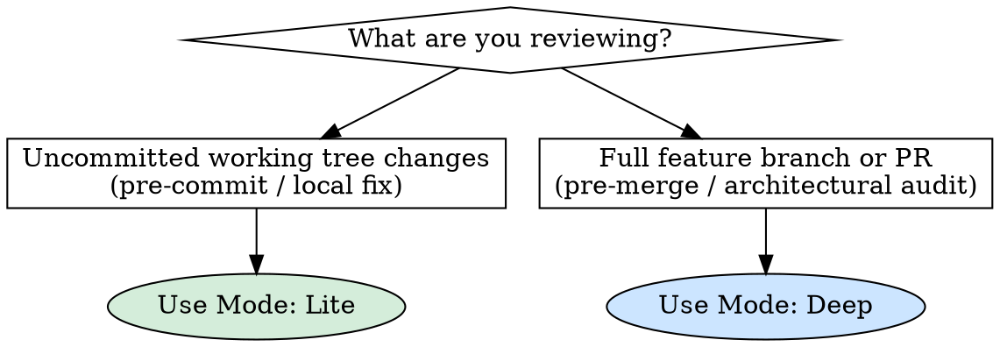

# Code Review

## Overview

Comprehensive code review workflow for Android & Kotlin projects. Inspects changes for architectural integrity, SOLID adherence, security vulnerabilities, Jetpack Compose performance, coroutine correctness, and Google Android best practices.

Supports two execution modes:
- **`Lite` (Pre-commit)**: Fast, high-signal review of uncommitted changes (`git diff`, `git diff --staged`).
- **`Deep` (Branch / PR)**: Full-scope architectural, cross-module, and OWASP MASVS review against the target base branch (`origin/main`, `develop`).

## When to Use



---

## Inspection Pillars

Review the diff across four core areas:

### 1. Security & Attack Surface
- **Data Storage & Secrets**:
  - Hardcoded API keys, bearer tokens, or credentials committed in code, Gradle configs, or BuildConfig.
  - Sensitive tokens stored in plaintext files, world-readable directories, or unencrypted local databases (enforce **Android Keystore**, encrypted DataStore, or SQLCipher where required; avoid deprecated storage).
  - PII or sensitive data leaking through logs (`Log.d/v`, unmasked tokens) or background snapshots/clipboard.
- **Network & Cryptography**:
  - Cleartext HTTP network traffic enabled (`android:usesCleartextTraffic="true"` or permissive `network_security_config.xml`).
  - Trusting all certificates (`X509TrustManager` bypasses), disabled hostname verification, or weak cryptographic algorithms (MD5, SHA-1, hardcoded DES/AES keys).
  - Lack of certificate pinning on sensitive endpoints where appropriate.
- **Component & Platform Security**:
  - Unprotected exported components (`Activity`, `Service`, `Receiver`, `Provider`) in `AndroidManifest.xml` without permissions or explicit `android:exported="false"`.
  - Insecure Intent Redirection (forwarding untrusted incoming intents to internal components) and unsafe intent extras deserialization (`getParcelableExtra`, `getSerializableExtra`).
  - Deep Links and App Links handling untrusted path/query parameters without strict perimeter validation.
  - PendingIntents missing explicit immutability flags (`FLAG_IMMUTABLE` / `FLAG_MUTABLE`).
- **Input & Injection Defense**:
  - Raw dynamic SQLite queries susceptible to SQL injection (missing parameterized Room queries).
  - Dangerous WebView configurations: `setJavaScriptEnabled(true)` with enabled file/content scheme access (`setAllowFileAccess(true)`) or exposing JavaScript interfaces to untrusted origins.
- *(In Deep Mode)*: Cross-check against **OWASP MASVS** domains (`MASVS-STORAGE`, `MASVS-NETWORK`, `MASVS-PLATFORM`, `MASVS-CODE`).

### 2. Performance & Concurrency (Compose & Coroutines)
- **Jetpack Compose Performance**:
  - Recomposition churn caused by unstable parameters (unwrapped standard collections `List` / `Set` without `@Immutable` / kotlinx Immutable collections).
  - Heavy computation or allocations within composable scope without `remember` or `derivedStateOf`.
  - Missing keys in `LazyColumn` / `LazyRow` leading to list animation jank and view recycling degradation.
- **Coroutines & Asynchronous Scalability**:
  - Main-thread blocking (un-dispatched disk/network I/O, `runBlocking`, or CPU-bound loops on `Dispatchers.Main`).
  - Hardcoding dispatchers (`withContext(Dispatchers.IO)`) instead of injecting `CoroutineDispatcher` instances for deterministic testability.
  - Concurrency leaks: unconfined `GlobalScope`, non-lifecycle-aware scopes, missing structured concurrency child cancellation.
  - Swallowing `CancellationException` (e.g. `catch (e: Exception)` without rethrowing `CancellationException`), which breaks coroutine cancellation hierarchies.
  - Race conditions in shared state (unprotected mutable state across coroutines; prefer StateFlow / Arrow Optics).
- **Memory & Resource Management**:
  - Memory leaks via Activity/View context retention in long-lived singletons, ViewModels, or callbacks.
  - Collecting flows without lifecycle awareness (e.g. omitting `collectAsStateWithLifecycle()` in Compose or `repeatOnLifecycle` in Views), wasting resources while app is in background.
  - Unclosed cursor / database streams, leaking Flow collectors, or undisposed hardware/sensor listeners.

### 3. Architecture & SOLID (Android / Kotlin)
- **Single Responsibility (SRP)**:
  - ViewModel / Presenter handling multiple unrelated concerns (e.g. combining presentation state, network/database calls, and formatting).
  - Composables holding business or state management logic instead of stateless UI rendering.
  - Passing `ViewModel` instances deep down composable trees instead of state hoisting (passing immutable state down, emitting action lambdas up).
- **Open/Closed (OCP)**:
  - Extensibility via sealed hierarchies, strategy patterns, or Compose slot APIs rather than modifying core routing/when branches directly.
  - Fragile type checks instead of exhaustive `when` expressions on sealed interfaces.
- **Liskov Substitution (LSP)**:
  - Repository, UseCase, or DataSource implementations breaking interface contracts or throwing unexpected runtime exceptions instead of returning typed results (Arrow `Either<Error, T>`).
- **Interface Segregation (ISP)**:
  - Monolithic repository interfaces with dozens of methods; prefer granular interfaces or dedicated single-purpose UseCases (`{Action}{Entity}UseCase`).
- **Dependency Inversion (DIP)**:
  - High-level domain logic depending on concrete Android framework classes (`Context`, `Intent`, Room DAOs, Retrofit interfaces).
  - Manual concrete instantiation instead of Dependency Injection (Koin).
- **Android Architecture & Anti-Patterns (Google Best Practices)**:
  - **Single Source of Truth (SSOT)**: Emitting network responses directly into UI state while also caching in local DB, rather than observing the local DB/cache as the single authoritative stream.
  - **Unidirectional Data Flow (UDF)**: Exposing mutable state (`MutableStateFlow` or Compose `MutableState`) from ViewModels or Repositories instead of read-only `StateFlow` / immutable state.
  - **One-off UI Events**: Anti-patterns with `SharedFlow` with replay for one-off events (navigation, snackbars) causing duplicated events on configuration change or lost events when unobserved.
  - **Navigation Parameters**: Passing heavyweight data classes / Parcelables through navigation routes instead of minimal IDs (`postId: String`) with repository fetching on the destination screen.
  - **Modular Boundaries & Visibility**: Feature modules (`:feature:*`) must NOT depend directly on each other (only on `:shared:*` / `:core:*`). Visibility rules: internal components (ViewModels, UseCases, Repository implementations) must be declared `internal`.
  - **State Preservation**: Failing to handle process recreation / configuration changes with `SavedStateHandle`.
- **Error Handling & State Modeling**:
  - Use Arrow functional errors (`Either<Failure, Success>`, sealed error interfaces) rather than throwing business exceptions.

### 4. Code Simplification & Technical Debt
- **Idiomatic Kotlin**:
  - Clean use of extension functions, guard clauses (early returns), and standard library functions.
  - Eliminating pyramid-of-doom conditionals with `when` expressions or smart casting.
  - Arrow Optics (`@optics` + `updateCopy`) for state mutation over cumbersome copy nests.
- **Over-Engineering**:
  - Pass-through UseCases that merely wrap repository calls without adding validation, transformation, or domain logic.
  - Redundant abstractions, dead code, leftover debug logs (`Log.d`, `println`), or unnecessary mutable state.

---

## Execution Steps

### Mode: Lite (Working Tree / Pre-Commit)
1. **Extract Diff:**
   ```bash
   git status --short
   git diff
   git diff --staged
   ```
2. **Inspect modified lines and immediate callers.**
3. **Classify findings by priority.**
4. **Generate Lite Report.**

### Mode: Deep (Branch / PR)
1. **Identify Revision Range:**
   ```bash
   BASE_BRANCH=$(git remote show origin 2>/dev/null | grep 'HEAD branch' | cut -d' ' -f5)
   BASE_BRANCH=${BASE_BRANCH:-main}
   MERGE_BASE=$(git merge-base origin/$BASE_BRANCH HEAD 2>/dev/null || git merge-base $BASE_BRANCH HEAD)
   git log --oneline $MERGE_BASE..HEAD
   git diff --stat $MERGE_BASE..HEAD
   git diff $MERGE_BASE..HEAD
   ```
2. **Inspect full architectural impact across modules.**
3. **Classify findings by priority.**
4. **Generate Deep Report.**

---

## Output Formats

### Format: Lite Review
```markdown
# Code Review (Lite)

**Scope:** [Modified files, (+X / -Y) lines]
**Verdict:** [Ready to commit | Revisions needed before commit | Approved with suggestions]

## Summary
[1-2 sentences summarizing change quality and key observations]

---

## Findings (Ordered by Priority)

### High Priority
- **`file:line` - [Descriptive Title]**
  - **Pillar:** [Security | Performance | Architecture/SOLID]
  - **Problem:** Precise description of the flaw.
  - **Impact:** Technical consequence (vulnerability, runtime crash, data corruption).
  - **Suggested Fix:**
    ```kotlin
    // Corrected code ready to apply
    ```

### Medium Priority
- **`file:line` - [Descriptive Title]**
  - **Pillar:** [Architecture/SOLID | Performance | Security]
  - **Problem:** Explanation of architectural flaw, resource leak, or weak error handling.
  - **Impact:** Maintainability, stability, or resource impact.
  - **Suggested Fix:**
    ```kotlin
    // Refactored code snippet
    ```

### Low Priority (Simplification & Cleanup)
- **`file:line` - [Descriptive Title]**
  - **Pillar:** [Simplification | Best Practices]
  - **Problem:** Unnecessary complexity, excessive nesting, duplicate or dead code.
  - **Impact:** Cognitive load and code readability.
  - **Suggested Fix:**
    ```kotlin
    // Clean alternative
    ```

---

## Tests & Verification
- [ ] Are new or modified behaviors covered by automated tests (Unit tests with JUnit 5 / Turbine / Roborazzi screenshot tests)?
- [ ] Were edge cases (empty states, loading states, error states, network failures via `Either.Left`) verified?
- [ ] Do tests follow BDD naming conventions (``@Test fun `GIVEN ... WHEN ... THEN ...`()``)?
- [ ] Did local checks pass (`./gradlew ktlintCheck`, `./gradlew lintDebug`, `./gradlew testDebugUnitTest`)?

## Next Steps
[Clear verdict and prioritized actions before committing]
```

### Format: Deep Review
```markdown
# Code Review (Deep / PR)

**Range:** `<BASE_COMMIT>..<HEAD_COMMIT>`
**Verdict:** [Approved | Approved with suggestions | Changes required]

## Executive Summary
[2-3 sentences summarizing branch health, architectural coherence, and key observations]

---

## Findings (Ordered by Priority)

### High Priority
- **`file:line` - [Descriptive Title]**
  - **Pillar:** [Security | Performance | Architecture/SOLID]
  - **Problem:** Detailed explanation of the vulnerability, bug, or architectural failure.
  - **Impact:** System-level consequence in production, security, or data integrity.
  - **Suggested Fix:**
    ```kotlin
    // Solution code or resolution pattern
    ```

### Medium Priority
- **`file:line` - [Descriptive Title]**
  - **Pillar:** [Architecture/SOLID | Performance | Security]
  - **Problem:** Description of tight coupling, unhandled failure modes, or scalability concerns.
  - **Impact:** Long-term maintainability, system throughput, or reliability under load.
  - **Suggested Fix:**
    ```kotlin
    // Refactoring or architectural adjustment
    ```

### Low Priority (Simplification & Improvements)
- **`file:line` - [Descriptive Title]**
  - **Pillar:** [Simplification | Best Practices]
  - **Problem:** Over-engineered logic, cognitive complexity, or redundant code.
  - **Impact:** Code readability and maintenance overhead.
  - **Suggested Fix:**
    ```kotlin
    // Clean, simplified implementation
    ```

---

## Testing & Coverage
- [ ] Are new workflows covered with automated unit tests (JUnit 5 + Turbine for Flows/State, Object Mother test fixtures)?
- [ ] Are UI/Compose changes covered with Roborazzi screenshot tests (`./gradlew verifyRoborazziDebug`) where applicable?
- [ ] Were edge cases, failure states (sealed error classes via Arrow `Either`), and lifecycle/configuration changes validated?
- [ ] Do all tests follow BDD naming (``@Test fun `GIVEN ... WHEN ... THEN ...`()``)?
- [ ] Do CI validation checks pass (`./gradlew ktlintCheck`, `./gradlew lintDebug`, `./gradlew koverHtmlReportDebug`)?

## Verdict & Action Items
[Clear verdict and prioritized checklist before merging]
```

---

## Reviewer Rules
- Every finding MUST include an exact `file:line` reference.
- Base judgments strictly on actual diffs, not assumptions.
- Provide concrete, actionable code snippets for every finding.
- Prioritize strictly: security and reliability risks always precede stylistic considerations.
- Always highlight simplification opportunities; less equivalent code is always better.
